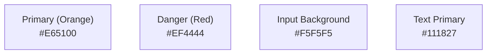

# Care Car Wash: Design Tokens & Theme Specification (`theme.md`)

This specification details the visual design system of the **Care Car Wash** application based on the UI design screens. It defines color palettes, typography, spacing, and border-radius tokens.

---

## 1. Color Palette

Based on the mobile screenshots, the design transitions from the default blue theme to a **Vibrant Orange** theme:



### CSS Variables Map
```css
:root {
  /* Brand Colors */
  --primary:        #E65100; /* Vibrant Orange (Primary Buttons, Active Icons, Selected Pills) */
  --primary-light:  #FF8008; /* Hover Orange state */
  --primary-dark:   #B23B00; /* Pressed Orange state */
  --primary-bg:     rgba(230, 81, 0, 0.08); /* Selection tint */
  --primary-glow:   rgba(230, 81, 0, 0.25); /* Button box-shadow */

  /* Neutral Backgrounds */
  --bg-app:         #FFFFFF; /* White background for mobile screens */
  --bg-card:        #FFFFFF; /* White background for cards */
  --bg-surface:     #F9FAFB; /* Light gray panel backgrounds */
  --bg-input:       #F5F5F5; /* Off-white input boxes (borderless styling) */

  /* Typography */
  --text-primary:   #111827; /* Dark black for headings and form labels */
  --text-secondary: #4B5563; /* Slate gray for descriptive texts and card details */
  --text-muted:     #9CA3AF; /* Light gray for placeholder texts and icons */
  --text-link:      #E65100; /* Orange links */

  /* Borders */
  --border:         #E5E7EB; /* Subtle card/navigation lines */
  --border-active:  #E65100; /* Focus ring/border colors */

  /* Feedback Colors */
  --success:        #10B981; /* Green for Completed states */
  --success-bg:     rgba(16,185,129,0.1);
  --warning:        #F59E0B; /* Yellow for Pending states */
  --warning-bg:     rgba(245,158,11,0.1);
  --danger:         #EF4444; /* Red for Cancel Booking button / Canceled status */
  --danger-bg:      rgba(239,68,68,0.1);
}
```

---

## 2. Typography

*   **Font Family:** `'Inter', -apple-system, BlinkMacSystemFont, 'Segoe UI', Roboto, sans-serif;`
*   **Scale:**
    *   `h1` (Main titles): `24px` to `28px` (Font-weight: 800)
    *   `h2` (Section titles): `18px` to `20px` (Font-weight: 700)
    *   `h3` (Card titles): `15px` to `16px` (Font-weight: 700)
    *   `body` (Inputs, labels, body text): `14px` (Font-weight: 500/600)
    *   `caption` (Subtext, meta information): `12px` (Font-weight: 500)
    *   `badge` / `nav` (Tiny badges and bottom navbar labels): `10px` (Font-weight: 600)

---

## 3. Border Radii (Corner Rounding)

*   **Small (`--radius-sm`):** `8px` — Used for small tag pills (e.g., Completed/Canceled badge lists).
*   **Medium (`--radius-md`):** `12px` — Used for form input elements (Email, Username, etc.).
*   **Large (`--radius-lg`):** `16px` — Used for parent containers and lists (e.g., Booking Cards).
*   **Extra Large (`--radius-xl`):** `24px` — Used for modal prompts and sheets.
*   **Full (`--radius-full`):** `9999px` — Used for pill buttons (Reschedule, Cancel, Edit My Profile) and selection toggles.
